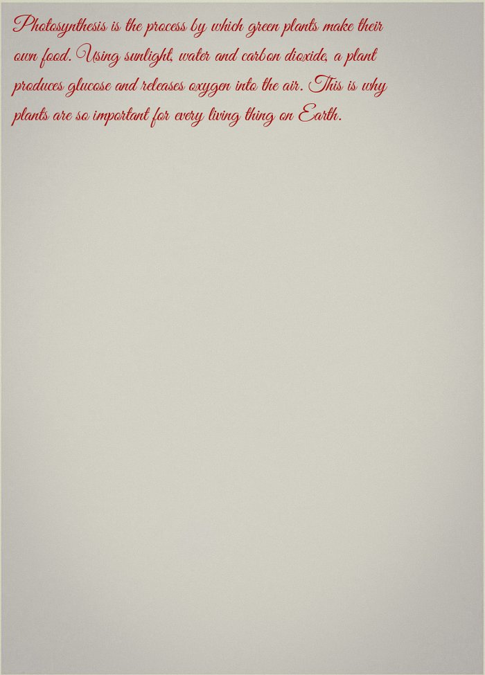
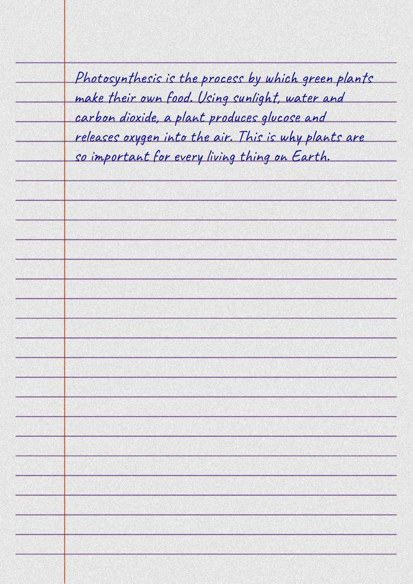
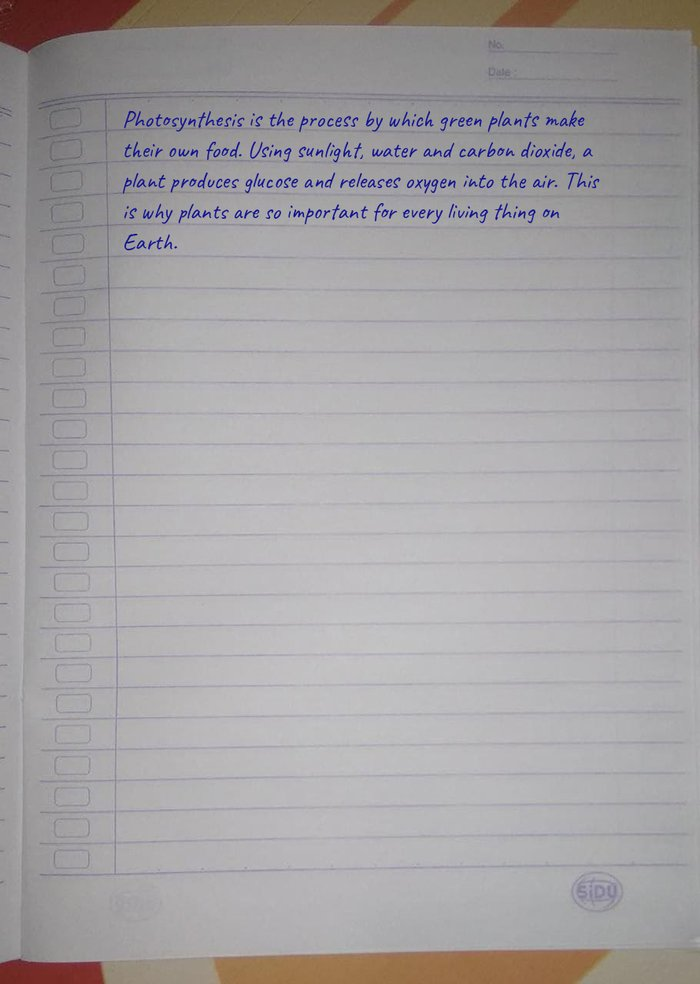
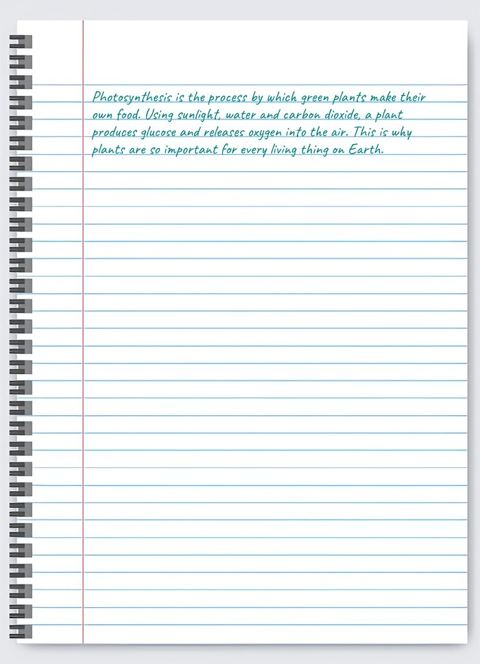
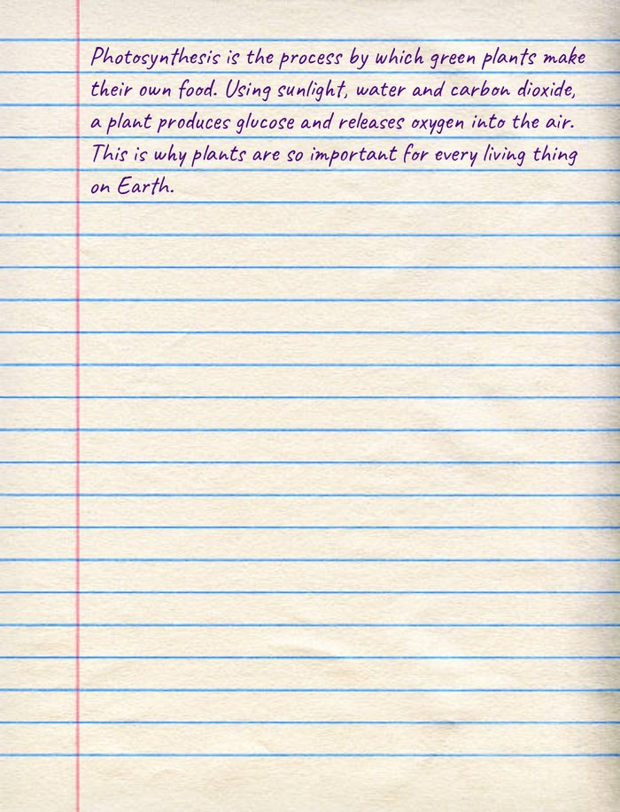
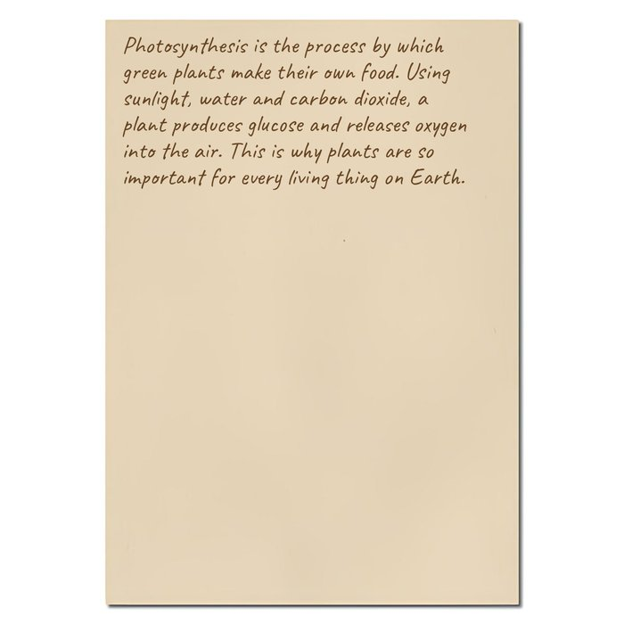
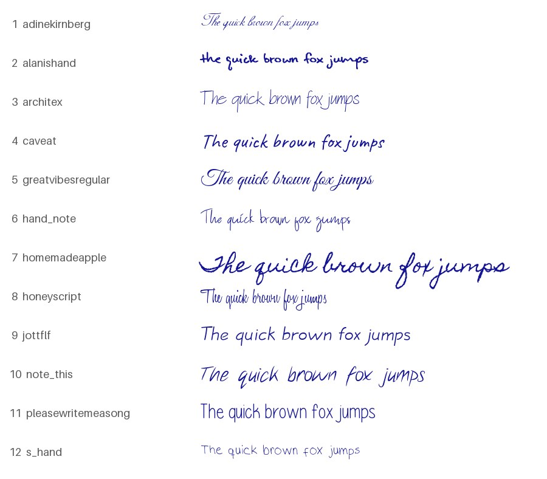
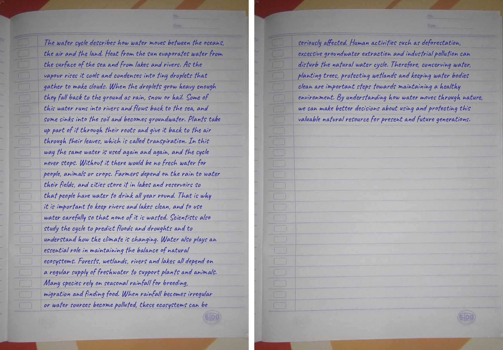

# AssignmentWriter

A Python package and command line tool that writes your text on a sheet of paper, in a handwriting font and ink colour of your choice. Pick a paper, a font and an ink, and get back an image of the page(s) (in form of pdf too) - all in a few lines of code.

[](https://pypi.org/project/assignmentwriter/) [](https://github.com/TheHritu/AssignmentWriter/blob/main/LICENSE)

## Installation

```
pip install assignmentwriter -U
```

## Quick Start

```python
from assignmentwriter import Assignment, AssignmentConfigOptions

config = AssignmentConfigOptions(Text="Hello World", Paper="lined", Font="caveat", Ink="blue")
result = Assignment(config).create()

result.save("page.png")  # saves the image
print(result)            # prints the saved path (if saved)
```

Or write a whole text file, on as many pages as it needs:

```python
config = AssignmentConfigOptions(File="essay.txt", Paper="spiral", Ink="teal")
result = Assignment(config).create()

result.save("essay.png")      # essay_1.png, essay_2.png, ...
result.save_pdf("essay.pdf")  # or all the pages in one PDF
```

## Previews

<table>
  <thead>
    <tr>
      <th>Paper</th>
      <th>Font</th>
      <th>Ink</th>
      <th>Preview</th>
    </tr>
  </thead>
  <tbody>
    <tr>
      <td><code>a4</code></td>
      <td><code>greatvibesregular</code></td>
      <td><code>red</code></td>
      <td><a href="results/sample_a4.jpg"></a></td>
    </tr>
    <tr>
      <td><code>lined</code></td>
      <td><code>caveat</code></td>
      <td><code>blue</code></td>
      <td><a href="results/sample_lined.jpg"></a></td>
    </tr>
    <tr>
      <td><code>rough</code></td>
      <td><code>caveat</code></td>
      <td><code>blue</code></td>
      <td><a href="results/sample_rough.jpg"></a></td>
    </tr>
    <tr>
      <td><code>spiral</code></td>
      <td><code>caveat</code></td>
      <td><code>teal</code></td>
      <td><a href="results/sample_spiral.jpg"></a></td>
    </tr>
    <tr>
      <td><code>wrinkled</code></td>
      <td><code>caveat</code></td>
      <td><code>purple</code></td>
      <td><a href="results/sample_wrinkled.jpg"></a></td>
    </tr>
    <tr>
      <td><code>cream</code></td>
      <td><code>caveat</code></td>
      <td><code>brown</code></td>
      <td><a href="results/sample_cream.jpg"></a></td>
    </tr>
  </tbody>
</table>

The colored papers are `cream`, `cyan`, `lightblue`, `lightgreen`, `lime`, `orange` and `pink`.

All 12 fonts:

[](results/fonts.jpg)

## Papers, fonts and inks

| Option | Values |
|--------|--------|
| `Paper` | `a4`, `lined`, `rough`, `spiral`, `wrinkled`, `cream`, `cyan`, `lightblue`, `lightgreen`, `lime`, `orange`, `pink` |
| `Font` | `adinekirnberg`, `alanishand`, `architex`, `caveat`, `greatvibesregular`, `hand_note`, `homemadeapple`, `honeyscript`, `jottflf`, `note_this`, `pleasewritemeasong`, `s_hand` |
| `Ink` | `blue`, `black`, `red`, `green`, `pencil`, `brown`, `purple`, `orange`, `teal`, `magenta`, or any hex colour such as `"131394"` |

A font can also be chosen by its number, 1 to 12, in the order shown above (`Font=4` is `caveat`).
Names are not case sensitive and spaces, dashes and underscores are ignored (`"Hand Note"` and `"Light Green"` work).

```python
from assignmentwriter import available_fonts, available_papers, INKS

print(available_papers())  # ['a4', 'lined', 'rough', 'spiral', 'wrinkled', 'cream', 'cyan', 'lightblue', 'lightgreen', 'lime', 'orange', 'pink']
print(available_fonts())   # ['adinekirnberg', 'alanishand', 'architex', 'caveat', 'greatvibesregular', 'hand_note', 'homemadeapple', 'honeyscript', 'jottflf', 'note_this', 'pleasewritemeasong', 's_hand']
print(list(INKS))          # ['blue', 'black', 'red', 'green', 'pencil', 'brown', 'purple', 'orange', 'teal', 'magenta']
```

> **Note:** `alanishand` draws the digits `2` and `5` very wide, so lines with those numbers can run off the page. Use another font for text with numbers.

## Configuration

`AssignmentConfigOptions` accepts these fields:

| Field | Type | Default | Description |
|-------|------|---------|-------------|
| `Text` | `str` | `None` | Text to write (give `Text` or `File`, not both) |
| `File` | `str` or `Path` | `None` | A UTF-8 text file to write instead of `Text` |
| `Paper` | `str` | `"a4"` | Paper to write on |
| `Font` | `str` | `"caveat"` | Handwriting font (name or number) |
| `Ink` | `str` | `"blue"` | Ink colour (name or hex) |
| `KeepLineBreaks` | `bool` | `False` | Start a new line wherever your text has one |
| `FontSize` | `int` | `None` | Override the font size |
| `MaxLineLength` | `int` | `None` | Override the number of characters per line |
| `MarginLeft` | `int` | `None` | Override the left margin (pixels) |
| `MarginTop` | `int` | `None` | Override the top margin (pixels) |
| `MarginBottom` | `int` | `None` | Override the space kept free at the bottom of each page (pixels) |
| `LineSpacing` | `float` | `None` | Override the space between lines (pixels) |

The last six are `None` by default, which keeps the layout that is tuned for the chosen paper and font.
An invalid value raises a `ValueError` as soon as the config is created.

By default your text is written as one paragraph, line breaks are treated as spaces.
Use `KeepLineBreaks=True` to keep headings, lists and paragraphs on their own lines.

### Text from a file

Pass the path of a UTF-8 text file as `File` instead of `Text`:

```python
from assignmentwriter import Assignment, AssignmentConfigOptions

config = AssignmentConfigOptions(File="essay.txt", Paper="lined", Ink="black", KeepLineBreaks=True)
result = Assignment(config).create()
result.save("essay.png")
```

A `ValueError` is raised if the file cannot be read, is empty, or if you give both `Text` and `File`.

### Get the tuned layout for a paper and font:

Returns a dictionary with the default layout values.

```python
from assignmentwriter import Assignment, AssignmentConfigOptions

config = AssignmentConfigOptions(Text="Hi", Paper="lined", Font="caveat")
print(Assignment(config).get_defaults())
# {'Paper': 'lined', 'Font': 'caveat', 'FontFile': 'caveat.ttf', 'FontSize': 85,
#  'MaxLineLength': 52, 'MarginLeft': 370, 'MarginTop': 333, 'MarginBottom': 130, 'LineSpacing': 22}
```

## Several pages

When your text is too long for one page, it continues on as many pages as it needs, so none of it is lost.
A line is never split between two pages.

[](results/sample_pages.jpg)

```python
config = AssignmentConfigOptions(File="essay.txt", Paper="spiral")
result = Assignment(config).create()

print(len(result))            # the number of pages
result.save("essay.png")      # essay_1.png, essay_2.png, ...
result.save_pdf("essay.pdf")  # or all the pages in one PDF
```

## `AssignmentResult`

`Assignment.create()` returns an `AssignmentResult` object:

```python
result = Assignment(config).create()

bool(result)                 # False if the pages could not be created
len(result)                  # the number of pages
result.image                 # the first page as a Pillow Image
result[1]                    # the second page, `for page in result` goes through all of them
result.save()                # assignment.png, or assignment_1.png, assignment_2.png ... for several pages
result.save("out.png")       # save to a specific path (png, jpg, ...), returns the list of paths
result.save("pages/")        # save in a folder
result.save_pdf("out.pdf")   # all the pages in one PDF (as wide as an A4 sheet), returns the path
str(result)                  # the paths of the last save, one per line ("" before saving)
```

Each page is drawn when you ask for it, so a very long text does not keep every page in memory at once.

If anything fails, `create()` returns a falsy `AssignmentResult` and logs the error. `save()` and `save_pdf()` return `None` and log the error if a file cannot be written.
A warning is logged if some lines run past the right edge of the page. Use a smaller `FontSize` / `MaxLineLength`.

---

# CLI

First, install the extra dependency for coloured output (optional, the CLI also works without it):

```
pip install "assignmentwriter[cli]"
```

---

## Usage

**No arguments** — launches an interactive prompt:

```
assignmentwriter
```

**Quick create** — just pass your text directly (saved as `assignment.png`):

```
assignmentwriter "Hello World"
```

**Pick a paper, font and ink:**

```
assignmentwriter "Hello World" --paper lined --font caveat --ink black
```

**Save the image to a file:**

```
assignmentwriter "Hello World" --save output.png
```

**Write the text of a file** (keep its line breaks):

```
assignmentwriter --file notes.txt --keep-line-breaks
```

**Long text** continues on more pages, saved as `essay_1.png`, `essay_2.png`, ... :

```
assignmentwriter --file essay.txt --paper spiral --save essay.png
```

**Save all the pages as one PDF:**

```
assignmentwriter --file essay.txt --paper spiral --pdf
```

**Plain output** (just the saved paths, no colors — useful for scripting):

```
assignmentwriter "Hello World" --as-text
```

---

## List

See every paper, font and ink:

```
assignmentwriter list
```

> **Add `--as-text` to get plain line-by-line output instead of a table.**

## On Some OS

On some operating systems, the CLI may not be available as `assignmentwriter` immediately after installation. If you encounter a "command not found" error, try running it with Python:

```
python -m assignmentwriter "Hello World"
```

---

## Fonts and papers

The code is MIT licensed, but the fonts and paper images have their own terms.
See [`NOTICE.md`](assignmentwriter/res/fonts/NOTICE.md) for the font details.

## Coffee is love, coffee is life.

<a href="https://www.buymeacoffee.com/hritu" target="_blank"></a>

## Contributing

Contributions are welcome — open an issue or submit a pull request.

## License

MIT © TheHritu